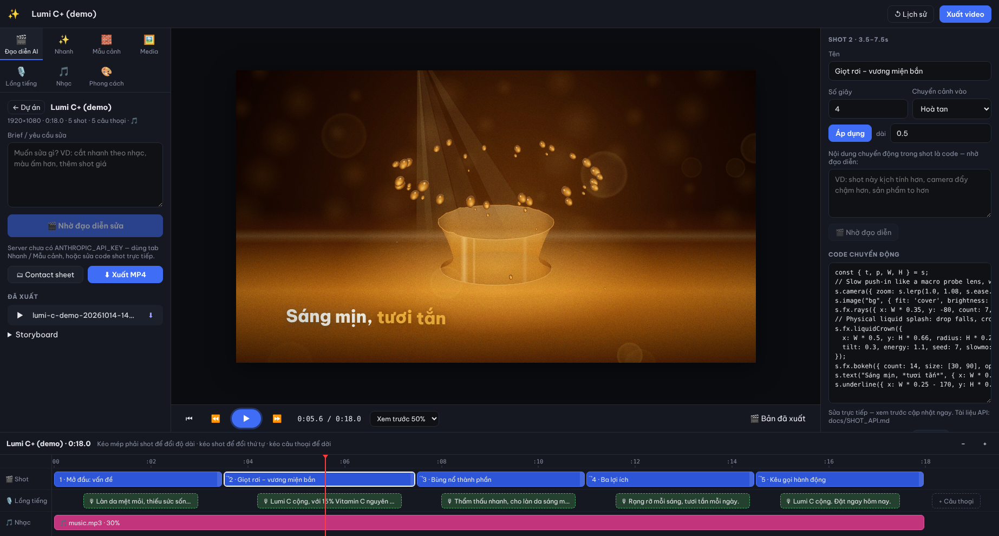

# Ennam Motion Studio

Phần mềm nội bộ cho team marketing tạo **motion video từ prompt + hình ảnh**.
Mỗi shot là **code chuyển động** chạy trên engine canvas có mô phỏng vật lý
(chất lỏng, trọng lực, va chạm, lò xo, khói, bọt, khúc xạ…). Đạo diễn AI (Claude)
xem chất liệu, viết code từng shot, **render thử và tự duyệt** contact sheet trước khi giao.
Xuất MP4 bằng Chromium headless + ffmpeg, có motion blur, nhạc và lồng tiếng.



## Chạy nhanh

```bash
npm install
npx playwright install chromium        # nếu máy chưa có Chromium (hoặc đặt CHROME_PATH)
cp .env.example .env                   # điền ANTHROPIC_API_KEY để bật Đạo diễn AI
npm start                              # http://localhost:5173
npm run seed                           # (tuỳ chọn) tạo dự án demo "Lumi C+"
npm run seed:nature                    # (tuỳ chọn) demo vật lý thiên nhiên: gió, lá rơi, nước chảy, giọt sương
npm run seed:tvc                       # (tuỳ chọn) TVC 30s Én Nam (xem docs/TVC_EN_NAM.md)
npm run seed:yearend                   # (tuỳ chọn) 3 dự án demo bộ mẫu Year End / Gala (thêm `-- --vertical` để có bản 9:16)
npm run seed:tet                       # (tuỳ chọn) 3 dự án demo bộ mẫu Tết Nguyên đán (thêm `-- --vertical` để có bản 9:16)
npm run seed:opening                   # (tuỳ chọn) 4 dự án demo bộ mẫu Khai trương / Kỷ niệm (thêm `-- --vertical` để có bản 9:16)
npm run library -- --provider pexels --query "forest stream" --type video   # tải chất liệu có giấy phép (library/sources.json)
pip install -r scripts/requirements.txt   # (tuỳ chọn) cho scripts/photo/prep.py và scripts/audio/*
```

Yêu cầu: Node ≥ 20, `ffmpeg`/`ffprobe` trong PATH.

## Deploy (link public để chạy thử)

App cần process chạy lâu (hàng đợi job, SSE), ổ đĩa bền (`DATA_DIR`), Chromium + ffmpeg → **không chạy được trên Vercel/Netlify (serverless)**. Dùng container:

- **Render (khuyên dùng):** Dashboard → New → Blueprint → chọn repo → nhập `ANTHROPIC_API_KEY`, `APP_PASSWORD` → Deploy. Cấu hình ở `render.yaml` (gói Standard + ổ 10 GB, region Singapore).
- **Fly.io / Railway / VPS:** build `Dockerfile`, gắn volume vào `/data`, đặt các biến như trên.
- **Thử nhanh từ máy dev (không cần tài khoản):** `npm start` rồi `cloudflared tunnel --url http://localhost:5173` → link `*.trycloudflare.com` tạm thời (tắt máy là mất link).

Link public **luôn đặt `APP_PASSWORD`** hoặc tạo tài khoản (`npm run user:add`) — không thì ai có link cũng dùng được Đạo diễn AI bằng API key của team. Container dùng Chromium ghim từ `@sparticuz/chromium` (`scripts/docker-start.sh`).

## Biến môi trường

| Biến | Ý nghĩa |
|---|---|
| `ANTHROPIC_API_KEY` | Bật Đạo diễn AI |
| `DIRECTOR_MODEL` | Mặc định `claude-opus-5-5` |
| `DIRECTOR_PROMPT_CACHE` | Prompt caching cho đạo diễn (mặc định bật); đặt `0` để tắt khi đo đối chứng |
| `DIRECTOR_CONCURRENCY` | Số job đạo diễn chạy đồng thời (mặc định 2); job vượt giới hạn xếp hàng FIFO. Render luôn chạy từng job một |
| `JOBS_TEST_KINDS` | Chỉ dùng cho test (`scripts/test-jobs.js`, `test-auth.js`, `test-budget.js`; `1` = bật kind job giả và `POST /api/test/jobs`); không bật trên server thật |
| `APP_PASSWORD` | Mật khẩu chung cũ (Basic Auth, user bất kỳ). Khi chưa có tài khoản: bắt buộc cho cả team. Khi đã có tài khoản: còn được chấp nhận 30 ngày rồi bị bỏ — xem [Tài khoản](#tài-khoản--đăng-nhập) |
| `COOKIE_SECURE` | `1` = cookie phiên luôn có cờ `Secure`; bỏ trống = tự bật khi request qua HTTPS hoặc `X-Forwarded-Proto: https` |
| `TRUST_PROXY` | Đặt khi chạy sau reverse proxy / Cloudflare Tunnel (vd. `loopback` hoặc `1`) để rate limit đăng nhập theo IP thật (giá trị `trust proxy` của Express) |
| `AUTH_CACHE_MS` | Thời gian cache `users.json` (mặc định 30000 ms): khoá/sửa tài khoản từ bên ngoài server có hiệu lực trong khoảng này |
| `EMS_TOKEN` | Token cá nhân `ems_…` cho script dev chạy ở process riêng (`frame.js`, `sheet.js`, `bench.js`) khi server đã bật tài khoản |
| `PORT` | Mặc định 5173 |
| `DATA_DIR` | Nơi lưu dự án, chất liệu, video xuất (mặc định `./data`) |
| `RENDER_WORKERS` | Số trang Chromium render song song (mặc định = số nhân − 1) |
| `RENDER_CACHE_MAX_MB` | Giới hạn dung lượng cache đoạn render **mỗi dự án** (mặc định 2000 MB, dọn theo LRU); `0` = tắt cache (mọi lần xuất render lại toàn bộ). Xem [Xuất video & cache](#xuất-video--cache-theo-đoạn) |
| `CHROME_PATH` | Đường dẫn Chromium nếu không dùng bản của Playwright |
| `ELEVENLABS_API_KEY` / `ELEVENLABS_VOICE_ID` | Giọng đọc AI (tiếng Việt tốt) — tuỳ chọn |
| `OPENAI_API_KEY` | TTS thay thế qua `/audio/speech` — tuỳ chọn |
| `PEXELS_API_KEY` | Tải chất liệu có giấy phép từ Pexels qua `npm run library` — tuỳ chọn |
| `PIXABAY_API_KEY` | Tải chất liệu có giấy phép từ Pixabay qua `npm run library` — tuỳ chọn |

## Tài khoản & đăng nhập

Mỗi người đăng nhập bằng tài khoản riêng (lưu ở `DATA_DIR/users.json`); Lịch sử, job và token đạo diễn AI gắn với người thực hiện.

```bash
npm run user:add -- danny --admin --name "Danny"     # tạo admin đầu tiên (hỏi mật khẩu, không hiện ký tự)
echo "$PW" | npm run user:add -- lananh --name "Lan Anh" --password-stdin   # cho script cài đặt
```

- **Đăng nhập** ở `/login.html` → cookie phiên (HttpOnly, SameSite=Lax, 14 ngày, tự gia hạn khi dùng; phiên lưu phía server ở `DATA_DIR/sessions/`). Sai quá 10 lần / 15 phút / IP bị chặn tạm.
- **Tài khoản** (nút trên thanh trên cùng): đổi mật khẩu, xem chi phí AI tháng này (thanh đã dùng / hạn mức / %) và token đạo diễn đã dùng, tạo / thu hồi **API token cá nhân** (`Authorization: Bearer ems_…`, dùng cho script hoặc app mobile). Token chỉ hiện một lần khi tạo; server chỉ lưu SHA-256.
- **Quản trị** (admin): thêm tài khoản, khoá / mở khoá, đặt lại mật khẩu, xem token + USD + % hạn mức đạo diễn AI theo người theo tháng, đặt hạn mức và "Nới hạn mức" (xem [Hạn mức chi phí AI](#hạn-mức-chi-phí-ai)). Khoá một người → phiên và token của người đó bị từ chối ngay (sửa `users.json` từ ngoài: trong `AUTH_CACHE_MS`, mặc định 30 s).
- Usage đạo diễn ghi ở job (`job.usage`, `job.usageUsd`, `job.userId`) và cộng dồn vào `DATA_DIR/usage/<YYYY-MM>.jsonl` (`{ at, userId, projectId, jobId, usage, model, usd, pricingVersion }`, không có brief hay secret; tháng theo giờ Việt Nam) — job bị dọn sau 6 giờ nhưng log tháng thì giữ.
- Dữ liệu trước khi có tài khoản (snapshot Lịch sử, job không có `userId`) vẫn hiển thị, người thực hiện là **"không rõ"**.

### Hạn mức chi phí AI

Mỗi lần chạy đạo diễn được quy ra **USD ước tính** ngay lúc ghi usage, theo bảng giá `config/pricing.json` (giá chính thức của Anthropic theo model × 4 loại token: input, output, ghi cache 5 phút, đọc cache; có `version`, `source`, `verifiedAt`). Mỗi dòng usage lưu `usd` + `pricingVersion`, nên đổi bảng giá **không** làm đổi số tháng cũ. Cần đổi giá mà không deploy: đặt `DATA_DIR/pricing.json` cùng cấu trúc (`version` mới + `models` cần ghi đè). Model không có trong bảng → tính theo giá của `DIRECTOR_MODEL` và log cảnh báo. Dòng usage cũ (trước khi có USD) được ước tính theo bảng giá hiện tại (đánh dấu `*` trên bảng Quản trị).

- **Hạn mức tháng** (USD, tháng theo giờ Việt Nam UTC+7, tự reset đầu tháng) đặt trên trang Quản trị: mặc định theo vai trò (`member`, `admin`), hạn mức riêng từng người (để trống = không giới hạn, "Theo vai trò" = bỏ ghi đè), và nhóm **"Chung"** cho usage chưa gắn người (mật khẩu chung `APP_PASSWORD` / chế độ mở). Lưu ở `DATA_DIR/budgets.json`, có hiệu lực ngay. **Chưa đặt gì = không giới hạn** (hành vi như trước).
- **≥ 80%**: banner cảnh báo trên thanh trên cùng và trang Tài khoản. **≥ 100%**: tạo job đạo diễn mới (cả "Chạy lại") bị từ chối `402` với thông báo "Đã hết hạn mức tháng — liên hệ admin", không job nào được xếp hàng; job đang chạy vẫn chạy hết (có thể vượt nhẹ).
- **Nới hạn mức**: admin bấm "Nới hạn mức" trên bảng usage, nhập số USD + lý do → cộng vào hạn mức **tháng hiện tại** của người đó (hoặc nhóm "Chung"), có hiệu lực ngay. Nhật ký `DATA_DIR/budget-log.jsonl` (ai / khi nào / bao nhiêu / lý do) hiện ở trang Quản trị.

**Chuyển tiếp từ `APP_PASSWORD`:**

| Trạng thái | Đăng nhập |
|---|---|
| Chưa có tài khoản, không đặt `APP_PASSWORD` | Không yêu cầu (như trước) |
| Chưa có tài khoản, có `APP_PASSWORD` | Basic Auth mật khẩu chung như cũ + banner "Hãy tạo tài khoản admin" |
| Đã có ≥ 1 tài khoản | Phiên / token. `APP_PASSWORD` vẫn vào được thêm **30 ngày** kể từ lúc tạo tài khoản đầu tiên (`firstUserAt` trong `users.json`) kèm header `X-Auth-Warning`, cảnh báo trong log và banner; trang login có link "dùng mật khẩu chung cũ". Hết 30 ngày → bị từ chối |

`/review/*` và tài nguyên của trang login nằm ngoài đăng nhập. Trang render headless của server dùng một token nội bộ ngẫu nhiên theo process (chỉ nhận từ loopback); script dev chạy riêng (`frame.js`, `sheet.js`, `bench.js`) cần `EMS_TOKEN` khi server đã có tài khoản.

## Giao diện

- **Đạo diễn AI** — nút **⚡ Xem nhanh** (bản nháp 12 fps, 1/3 độ phân giải, không motion blur, phát ngay trong editor, không vào danh sách bản xuất) cạnh **⬇ Xuất MP4**; dòng *Cache render* hiện dung lượng cache đoạn của dự án + link **Xoá cache**. Form **Brief** có cấu trúc (sản phẩm/sự kiện, thông điệp chính, cảm xúc dạng chip chọn nhiều + tự nhập, thời lượng, kênh/tỉ lệ khung, CTA, ghi chú tự do) lưu cùng dự án (`project.brief`, tự lưu như mọi chỉnh sửa, có trong Lịch sử, mở từ máy khác vẫn còn); khi đã có shot thêm ô *Yêu cầu sửa lần này* → Claude dựng/sửa cả video; Contact sheet; Xuất MP4; danh sách bản đã xuất; Storyboard. Brief cũ chỉ nằm trong `sessionStorage` của trình duyệt được tự chuyển vào *Ghi chú tự do* một lần khi mở dự án.
- **Nhanh** — dựng ngay từ công thức (Quảng cáo sản phẩm, Teaser, Recap sự kiện) không cần AI. Bộ lọc **Theo mùa** hiện các bộ mẫu mùa sự kiện; chọn công thức theo mùa thì form chuyển sang thông tin khách (công ty, tên sự kiện, dòng phụ, chủ đề, ngày giờ, địa điểm, màu nhấn) và điền sẵn vào trường sửa được của mọi shot.
- **Mẫu cảnh** — chèn cảnh mẫu (giọt rơi vương miện, rót chất lỏng, sản phẩm rơi nảy, bùng nổ thành phần, 3 lợi ích, CTA, Ken Burns, Hoàng hôn — trời vật lý `timeOfDay`); bộ lọc **Theo mùa** hiện cảnh của từng bộ mẫu mùa.
- **Media** — tải ảnh/video/nhạc. Đặt tên & mô tả để đạo diễn hiểu vai trò. PNG nền trong suốt cho sản phẩm.
- **Lồng tiếng** — câu thoại trên timeline, tạo giọng AI hoặc tải thu âm.
- **Nhạc** — nhạc nền, âm lượng, fade.
- **Phong cách** — Brand Kit đang dùng (đổi kit, khoá / bỏ khoá phiên bản), grade màu, vignette, bloom, hạt phim, letterbox, bảng màu thương hiệu (dự án có kit → màu của kit, chỉ đọc), khung hình (16:9, 9:16, 1:1, 4:5, 4K), fps.
- **Brand Kit** (nút trên thanh trên cùng, hoặc ở màn hình Dự án) — kit dùng chung giữa các dự án: tên, logo PNG nền trong suốt, 3–5 màu theo vai trò (Chính / Nhấn / Chữ bắt buộc, thêm Phụ / Nền), font tiêu đề + nội dung (font có sẵn hoặc tải `.ttf/.otf/.woff/.woff2` — **bắt buộc ghi nguồn/giấy phép**, để trống thì kit hiện cảnh báo), grade mặc định, giọng TTS, nhạc nhận diện, câu chữ bắt buộc / cấm, outro. Tạo / sửa / nhân bản / xoá; mỗi lần sửa kit tăng phiên bản. Chọn kit khi **tạo** hoặc **nhân bản** dự án (mặc định bản sao giữ kit của bản gốc), kèm tuỳ chọn **Khoá phiên bản kit**: khoá → dự án giữ bản chụp phiên bản lúc gán; không khoá → mở lại dự án (và lúc render / gọi đạo diễn) tự dùng phiên bản mới nhất. Kit áp vào xem trước và bản xuất MP4: `s.palette`, `s.brand` (logo, màu, font), field màu khai báo `brandColor` (mẫu theo mùa: màu nhấn + logo lấy từ kit), font tải lên được nạp trước khi render. Đạo diễn AI nhận tóm tắt kit (màu, font, logo, câu bắt buộc / cấm, outro) trong user turn; QA báo khi chữ của shot (code, field, lồng tiếng) chứa câu cấm.
- **Cột phải** — thuộc tính shot, chuyển cảnh, mục **Nội dung** (form tự sinh từ các `s.field` của shot: chữ, màu, số, ảnh từ Chất liệu; gõ là xem trước đổi ngay, không gọi AI; *Về mặc định* bỏ giá trị đã sửa), *Nhờ đạo diễn* cho riêng shot, sửa code trực tiếp (xem trước cập nhật ngay).
- **Timeline** — kéo mép phải shot đổi độ dài, kéo shot đổi thứ tự, kéo câu thoại để dời, bấm thước để tua.
- **Job** (tab Đạo diễn AI) — tiến độ đạo diễn/xuất video cập nhật tức thì qua SSE (tự chuyển sang poll nếu SSE lỗi); huỷ được cả job đang chờ. Job lưu ở `DATA_DIR/jobs/`, nên khi server khởi động lại giữa chừng job hiện **⚠️ gián đoạn** kèm log cũ và nút **↻ Chạy lại**.
- **Lịch sử** — mọi lần AI/mẫu thay đổi và mỗi phiên sửa brief (*Trước khi sửa brief*, gộp các lần gõ cách nhau < 2 phút) đều lưu phiên bản cũ, khôi phục 1 chạm; mỗi bản ghi tên người thực hiện (bản cũ: "không rõ"). Danh sách job cũng hiện tên người tạo job.
- **Tài khoản / Quản trị / Đăng xuất** — góc phải thanh trên cùng (khi server đã có tài khoản), xem [Tài khoản](#tài-khoản--đăng-nhập).

#### Bộ mẫu theo mùa
| Bộ | Cảnh (vật lý, tất định) | Công thức nhanh |
|---|---|---|
| **Year End / Gala** (`server/templates/seasonal/yearend.js`) | đèn moving-head quét qua khói, bokeh vàng, pháo giấy kim tuyến bắn từ hai góc + tia lửa + kim tuyến rơi, số năm 2026 → 2027 cuộn và bùng nổ, đếm ngược 10 → 0 trên mặt đồng hồ, thiệp mời viền vàng, lời chào | Teaser 10s · Mở màn LED 20s · Countdown 10→0 (10s) |
| **Tết Nguyên đán** (`server/templates/seasonal/tet.js`) | cành mai vàng & đào hồng nở rồi uốn theo gió (gốc cứng, ngọn mềm), cánh hoa rơi lượn + lộn trong cùng trường gió, đèn lồng đỏ thả xuống bằng lò xo rồi đung đưa như con lắc tắt dần (tua rua trễ pha), khói nhang cuộn, pháo hoa tia lửa, hoa văn trống đồng Đông Sơn, câu đối đỏ mở cuộn + hoành phi, thiệp sơn mài góc cắt giấy; mặc định *Xuân Đinh Mùi 2027* (năm/can chi là trường sửa được), hai màu nhấn vàng kim + đỏ son | Chúc Tết 15s · Thư mời Khai xuân 11s · Mở màn LED 20s |
| **Khai trương / Kỷ niệm** (`server/templates/seasonal/opening.js`) | cắt băng lụa: băng là dây vật lý (Verlet, nơ hoa nặng ở giữa) được kéo căng, kéo vàng khép lại cắt, hai nửa băng rơi đung đưa quanh cột như con lắc tắt dần và xoắn lộ mặt sau satin; pháo giấy + kim tuyến + dây xoắn bắn từ hai bên (trọng lực, lực cản, xoáy rối), đèn quét + vệt sáng lướt, đếm ngược trong vòng bóng đèn marquee, bóng bay nổi theo lực đẩy và lắc theo gió, “Kỷ niệm X năm” đếm lên trong vòng nguyệt quế vàng mọc dần; ba màu là trường sửa được: vàng kim (theo màu Nhấn của Brand Kit), nền (theo màu Chính của kit), băng lụa | Teaser 8s · Countdown 5→0 (8s) · Cảm ơn khách 10s · Kỷ niệm X năm 11s |

Mọi chữ, ngày, địa điểm, tên khách, logo và màu nhấn là `s.field`; màu nhấn (và màu nền của bộ Khai trương) khai báo `brandColor` nên dự án có Brand Kit tự lấy màu kit, logo mặc định là logo của kit (sửa ở Inspector, không cần AI); bố cục theo tỉ lệ W/H nên chạy cả 16:9 và 9:16. Mẫu theo mùa **không** nằm trong ví dụ few-shot của đạo diễn (giữ system prompt cố định để cache). Thêm bộ mới: tạo `server/templates/seasonal/<mùa>.js` (export `SEASON, DEFAULTS, FORM_FIELDS, SCENES, RECIPES` với `season`) và thêm vào mảng `SEASONAL` trong `server/templates.js`.

Phím tắt: `Space` phát/dừng · `←/→` từng khung (`Shift` = 1 giây) · `Home` về đầu · `Ctrl/⌘+S` lưu.

## Xuất video & cache theo đoạn

| Mức | fps | Độ phân giải | Motion blur | x264 | Dùng cho |
|---|---|---|---|---|---|
| **⚡ Xem nhanh** (`preview`) | 12 | 1/3, giữ nhỏ (không phóng lên) | tắt | `ultrafast`, crf 28 | duyệt nhịp / bố cục; lưu ở `preview/` (chỉ giữ bản mới nhất), không vào danh sách bản xuất |
| Nháp (`draft`) | theo dự án | 1/2 rồi phóng lên | tắt | `veryfast`, crf 23 | duyệt nội bộ |
| Chuẩn (`standard`) | theo dự án | đầy đủ | 3 mẫu/khung | `medium`, crf 18 | gửi khách |
| Cao nhất (`high`) | theo dự án | đầy đủ | 6 mẫu/khung | `slow`, crf 15 | màn LED / TVC |

**Cache theo đoạn (#29).** Mỗi lần xuất, timeline được chia thành các *đoạn* khung liên tiếp: phần thân của từng shot, và mỗi vùng chuyển cảnh (kể cả khung có mẫu motion blur vắt qua chỗ cắt thẳng) là một đoạn riêng gắn với cả hai shot kề. Mỗi đoạn được encode thành một MP4 riêng (cùng tham số x264, GOP đóng) và lưu ở `DATA_DIR/projects/<id>/cache/`; lần xuất sau chỉ render các đoạn có đầu vào thay đổi, rồi ghép bằng ffmpeg concat (không encode lại), kiểm tra đủ số khung, sau đó trộn nhạc + lồng tiếng như cũ. Sửa một field ở một shot → chỉ render lại đoạn của shot đó và hai vùng chuyển cảnh kề.

- Khoá của đoạn gồm: phiên bản engine (nội dung `engine/**`, trang render, font, bản Chromium + cờ, bản ffmpeg), mức chất lượng + tham số encoder (fps xuất, scale, số mẫu motion blur, crf, preset), kích thước/fps/style/bảng màu dự án, bản chụp Brand Kit (`project.brand`: id, version, bảng màu, font, logo, outro) cùng **nội dung** file font và logo của kit (font nạp qua FontFace nên không đi qua bước ghi chất liệu đã đọc), khoảng khung, toàn bộ dữ liệu của các shot mà đoạn phụ thuộc (code, `fields`, tên, vị trí, thời điểm bắt đầu, thời lượng, chuyển cảnh — chỉ bỏ `notes`), và **nội dung** (SHA-256) của mọi chất liệu mà đoạn thực sự đọc khi render (trang render ghi lại). Đổi bất kỳ thứ nào → đoạn đó render lại; dời một shot (đổi thời lượng shot trước) → các đoạn phía sau render lại.
- Job báo `tái sử dụng X/Y đoạn (a/b khung) · tiết kiệm ~Ns`; `job.result.cache` có số liệu chi tiết.
- Dung lượng: tối đa `RENDER_CACHE_MAX_MB` mỗi dự án (mặc định 2000), đoạn lâu không dùng bị xoá trước (LRU). Xoá dự án là xoá luôn cache; **Xoá cache** trong tab Đạo diễn AI hoặc `DELETE /api/projects/:id/cache`. Xoá thư mục cache giữa lúc đang xuất không làm hỏng bản xuất (đoạn đang dùng đã được hard-link vào thư mục tạm của job).

| Route | Ý nghĩa |
|---|---|
| `POST /api/projects/:id/render` `{ quality }` | Tạo job xuất: `preview` \| `draft` \| `standard` \| `high` (giá trị khác → 400) |
| `GET /api/projects/:id/cache` | `{ segments, bytes, maxBytes }` |
| `DELETE /api/projects/:id/cache` | Xoá cache đoạn của dự án → `{ ok, freed, segments, bytes, maxBytes }` |

## Đóng góp

Mở PR vào `main`; CI (`.github/workflows/ci.yml`) chạy `npm run check` — PR chỉ được merge khi CI xanh. Merge bằng squash.

## Kiến trúc

Xem [docs/ARCHITECTURE.md](docs/ARCHITECTURE.md) và API viết shot ở [docs/SHOT_API.md](docs/SHOT_API.md).

## Script dev

```bash
npm run check                                    # quality gate (cũng chạy trên CI cho mỗi PR)
node scripts/sheet.js <projectId> out.jpg 3     # contact sheet render thật
node scripts/frame.js <projectId> <shot> 0.5,1.2 out   # khung full-res của 1 shot
node scripts/bench.js <projectId> 3              # đo thời gian render từng shot
node scripts/ui-shot.js "#p=<projectId>"         # chụp giao diện
node scripts/test-auth.js                        # test tài khoản: 401, đăng nhập, rate limit, chuyển tiếp APP_PASSWORD, khoá user, token băm, userId trên job/lịch sử (tự bật server con)
node scripts/test-budget.js                      # test hạn mức chi phí AI: USD theo bảng giá (tính tay), tháng UTC+7, cảnh báo 80% / chặn 100%, nới hạn mức, restart (tự bật server con)
node scripts/test-jobs.js                        # test hàng đợi job: restart → interrupted, giới hạn song song, huỷ, render đọc project lúc chạy, SSE (tự bật server con)
node scripts/test-director-cache.js              # test offline: cache_control + cộng dồn token của đạo diễn (không gọi API)
node scripts/test-director-review.js             # test offline vòng duyệt: approve_cut / patch_shots, prefix cache giống hệt mọi lượt, guard vòng cuối (stub client + stub render thử)
node scripts/test-brief.js                       # test offline brief có cấu trúc: chuẩn hoá, JSON gọn gửi đạo diễn (stub client), snapshot "brief" + khôi phục (tự bật server con)
node scripts/test-qa.js                          # QA đo được: 5 shot cố ý lỗi phải bị phát hiện + guard vòng cuối (mock, không gọi API)
node scripts/test-brand.js                       # Brand Kit: CRUD + version, khoá/theo kit mới nhất, cảnh báo giấy phép font, route sau đăng nhập, render headless dùng màu/logo/font kit (so pixel), khối kit trong user turn, QA câu cấm (~6s)
node scripts/test-seasonal.js                    # mẫu theo mùa: mọi công thức ở 16:9 + 9:16 qua QA inspect, không chữ tràn/đen/trống; Tết + Khai trương thêm lượt nội dung dài nhất (~30s)
node scripts/test-render-cache.js                # cache theo đoạn: bản ghép từ cache = bản render đầy đủ (ngưỡng golden), invalidation từng loại đầu vào, xoá cache giữa chừng, LRU, Xem nhanh (~30s, cần ffmpeg)
node scripts/bench-render-cache.js               # đo: xuất đầy đủ vs sửa 1 field rồi xuất lại (dự án demo 6 shot, 20s, standard) và Xem nhanh vs standard (vài phút)
node --env-file=.env scripts/director-bench.js   # đo token đạo diễn có/không cache trên 3 brief mẫu (tốn phí API thật)
node --env-file=.env scripts/director-bench.js --review  # so output token vòng duyệt: nộp lại cả bản (cũ) vs approve_cut/patch_shots (tốn phí API thật)
```

`director-bench.js` cần `ANTHROPIC_API_KEY` và server đang chạy; nếu chưa có dự án demo "Lumi C+ (demo)" nó tự chạy `scripts/seed-demo.js`.
Mặc định mỗi brief chạy 2 lần (không cache rồi có cache) và in bảng markdown 4 trường token + % thay đổi chi phí input quy đổi
(`input + 1.25 × cache write + 0.1 × cache read`). Tuỳ chọn: `--n 1..3` số brief, `--no-cache` chỉ chạy bản tắt breakpoint,
`--cache-only` chỉ chạy bản có cache, `--project <id>` dùng dự án khác. Token của lần chạy gần nhất được lưu ở
`project.lastDirector.usage` (`total` + `rounds`) và hiện ở tab Đạo diễn AI.

### API job

| Route | Ý nghĩa |
|---|---|
| `GET /api/jobs?project=<id>` · `GET /api/jobs/:id` | Trạng thái job: `queued` → `running` → `done` / `error` / `cancelled`, hoặc `interrupted` (server khởi động lại khi job đang chạy/chờ) |
| `POST /api/jobs/:id/cancel` | Huỷ job đang chạy hoặc đang chờ (job chờ bị huỷ không bao giờ chạy) |
| `POST /api/jobs/:id/retry` | "Chạy lại": tạo job mới cùng `kind` + `params` (trường `retryOf` trỏ về job cũ) |
| (mọi job) | `userId` người tạo (null = job cũ / không đăng nhập) + `userName` tên hiển thị; job đạo diễn xong có `usage` (tổng 4 trường token), `usageUsd`, `usageModel`, `pricingVersion` |
| `GET /api/jobs/:id/events` | SSE: `event: job` (JSON job đầy đủ) mỗi khi đổi trạng thái/tiến độ; tự đóng khi job kết thúc; heartbeat `: ping` mỗi 15 s |
| `GET /api/projects/:id/jobs/events` | SSE theo dự án: `event: jobs` (danh sách ban đầu) rồi `event: job` cho mọi job của dự án |

Job render đọc lại dự án **lúc bắt đầu chạy** (không phải lúc bấm xuất) và ghi `projectUpdatedAt` của bản đã dùng. Nếu đặt sau reverse proxy, tắt buffering cho `/api/*/events` (server đã gửi `X-Accel-Buffering: no`).

### API tài khoản

| Route | Ý nghĩa |
|---|---|
| `POST /api/auth/login` `{ username, password }` · `POST /api/auth/logout` | Đăng nhập (đặt cookie `ems_session`) / đăng xuất |
| `GET /api/auth/status` | `{ mode: open\|legacy\|accounts, via, user, banner, transitionEndsAt }` (công khai) |
| `GET/POST /api/account/tokens` · `DELETE /api/account/tokens/:id` | Token cá nhân: liệt kê / tạo (trả token gốc một lần) / thu hồi |
| `POST /api/account/password` `{ current, password }` · `GET /api/account/usage?month=YYYY-MM` | Đổi mật khẩu (đăng xuất các phiên khác) · usage của mình: `{ month, jobs, total, usd, warn, budget }` |
| `GET /api/budget` | Hạn mức của người gọi (không đăng nhập tài khoản → nhóm "Chung"): `{ month, limit, base, raised, source, used, pct, warn, blocked }` (`limit: null` = không giới hạn) |
| `GET/POST /api/admin/users` · `PATCH /api/admin/users/:id` `{ status, role, name }` · `POST /api/admin/users/:id/password` | Admin: tài khoản, khoá/mở, đặt lại mật khẩu |
| `GET /api/admin/usage?month=YYYY-MM` | Admin: token + `usd` + `budget` theo người trong tháng (`rows[]`, `months[]`, `pricing`); tháng hiện tại có thêm dòng cho người có hạn mức nhưng chưa dùng |
| `GET /api/admin/budgets` · `PUT /api/admin/budgets` `{ roles: { member, admin }, shared, users: { <id>: số \| null \| 'role' } }` | Admin: xem / sửa hạn mức (USD/tháng; `null` = không giới hạn; `'role'` = bỏ ghi đè) + nhật ký nới tháng này |
| `POST /api/admin/budgets/raise` `{ userId \| null, amount, reason }` | Admin: nới hạn mức tháng hiện tại (`userId: null` = nhóm "Chung"); ghi `budget-log.jsonl` |

### API Brand Kit

Mọi route nằm sau đăng nhập (thành viên nào cũng quản lý được kit). Kit lưu ở `DATA_DIR/brands/<id>/brand.json` + `files/` (logo, font, nhạc; tên file bất biến). Mọi thay đổi tăng `version`; response có `warnings` (`font_license` khi font thiếu nguồn/giấy phép).

| Route | Ý nghĩa |
|---|---|
| `GET/POST /api/brands` · `GET/PUT/DELETE /api/brands/:id` | Liệt kê / tạo / xem / sửa (`name, palette[{role,color}], fonts{heading,body}, grade, voiceId, requiredPhrases[], bannedPhrases[], outro`) / xoá kit. Bảng màu 3–5 màu, vai trò không trùng, bắt buộc `primary`/`accent`/`text` (sai → 400) |
| `POST /api/brands/:id/duplicate` | Nhân bản kit (version 1, chép cả file) |
| `POST/DELETE /api/brands/:id/logo` · `POST/DELETE /api/brands/:id/music` | Logo (multipart `file`, chuyển PNG) / nhạc nhận diện |
| `POST /api/brands/:id/fonts` (multipart `file`, `name`, `license`, `role` = `heading`\|`body`) · `PATCH/DELETE /api/brands/:id/fonts/:fid` | Font tải lên, sửa tên / giấy phép, xoá |
| `GET /brands/:id/files/:file` | File của kit (màn hình kit) |
| `POST /api/projects` `{ …, brand: { id, locked } }` · `POST /api/projects/:id/duplicate` `{ brand }` | Gán kit khi tạo / nhân bản (`brand: null` = bỏ kit; bỏ trống khi nhân bản = giữ kit bản gốc) |
| `PUT /api/projects/:id/brand` `{ id, locked }` / `{ id: null }` | Đổi kit, khoá / bỏ khoá (bỏ khoá → phiên bản mới nhất), bỏ kit; snapshot Lịch sử `brand` |

`project.brand = { id, version, locked, kit }` do server quản lý (`PUT /api/projects/:id` không ghi đè được): `kit` là bản chụp dữ liệu kit, file kit được chép vào `assets/` của dự án với tiền tố `brand-` (không hiện trong Media). Lần gán kit đầu: áp grade mặc định; dự án chưa có nhạc → thêm nhạc nhận diện thành chất liệu nhạc. TTS dùng giọng của kit khi câu thoại chưa chọn giọng.

### Golden-frame (kiểm tra hình ảnh tự động)

`npm run check` render các fixture trong `test/golden/fixtures/` (chất lỏng, chữ tiếng Việt, `s.photo` với ảnh/depth/mask/flow tổng hợp, thiên nhiên WebGL, trời vật lý + mây 2 lớp (`sky`), hậu kỳ, mẫu Year End: đèn sân khấu + pháo giấy kim tuyến) ở scale 0.25 và so với ảnh trong `test/golden/expected/`:

- **Khớp ảnh** — pixel lệch > 8/255 bị tính là sai; quá 0.1% số pixel → FAIL. Ảnh `*.actual.png`, `*.expected.png`, `*.diff.png` (đỏ = lệch quá ngưỡng, vàng = lệch nhỏ) ở `test/golden/out/` (CI tải lên artifact `golden-diff`).
- **Tất định** — mỗi khung render 2 lần ở 2 trang mới → phải giống hệt từng bit. Lần thứ 3 theo thứ tự ngược cũng phải giống hệt (mỗi khung là hàm thuần của `t`, không phụ thuộc khung nào đã render trước — tua, xuất song song); lệch → FAIL, ảnh ở `test/golden/out/*.order-reverse.png`.
- **Hiệu năng** — ms/khung (đã chuẩn hoá theo một bài đo cố định của máy) so với `test/golden/expected/perf.json`; chậm hơn > 30% → FAIL trên CI, local chỉ WARN.

Chromium được cố định bằng devDependency `@sparticuz/chromium` (phiên bản khóa trong `package-lock.json`, chỉ Linux x64) để máy dev và CI raster giống nhau; font fallback dùng bộ font đi kèm gói.

```bash
node scripts/golden.js                 # chỉ chạy golden
node scripts/golden.js --only liquid,text
node scripts/golden.js --update        # thay đổi hình ảnh CÓ CHỦ ĐÍCH: ghi lại ảnh golden + baseline hiệu năng, commit kèm PR
SKIP_GOLDEN=1 npm run check            # bỏ qua golden khi chạy local (không được phép trên CI)
node test/golden/fixtures/make-assets.js   # sinh lại ảnh tổng hợp cho fixture s.photo
```

Thêm fixture: tạo `test/golden/fixtures/<tên>.json` (project JSON như `data/projects/<id>/project.json`, chất liệu đặt ở `fixtures/assets/`, khung cần chụp ở `golden.frames: [{ t, motionBlur }]`) rồi chạy `--update`. Biến tinh chỉnh: `GOLDEN_PIXEL_THRESHOLD`, `GOLDEN_MAX_RATIO`, `GOLDEN_PERF_TOLERANCE`, `GOLDEN_SCALE`.

### QA đo được của đạo diễn (`scripts/test-qa.js`)

Khi đạo diễn AI render thử, `window.__inspect` trả thêm số liệu mỗi shot ở 3 thời điểm cố định (độ sáng TB, độ lệch chuẩn độ sáng, ms/khung, khung chữ của `s.text`); `server/qa.js` đổi thành lỗi: khung đen/gần đen, khung trống một màu, chữ ra ngoài vùng an toàn 6%, > 500 ms/khung, lỗi runtime — gửi cho đạo diễn dạng text để tự sửa (ngưỡng là hằng số đặt tên ở đầu `server/qa.js`). Vòng cuối shot vẫn lỗi runtime → giữ code cũ chạy được và gắn cờ **⚠ Cần xem lại** trên timeline (`shot.needsReview`); cờ tự bỏ khi sửa code shot.

`npm run check` chạy `node scripts/test-qa.js` sau golden: render 5 shot cố ý lỗi trong `test/qa/shots/` (mỗi file mở đầu `// expect: <loại lỗi>`) + 1 shot lành qua đúng đường inspect của đạo diễn (Chromium cố định, server tạm) và yêu cầu phát hiện 100%, shot lành không bị báo; kèm test mock đạo diễn (stub client Anthropic) cho guard vòng cuối. Chỉ Linux x64 như golden.

